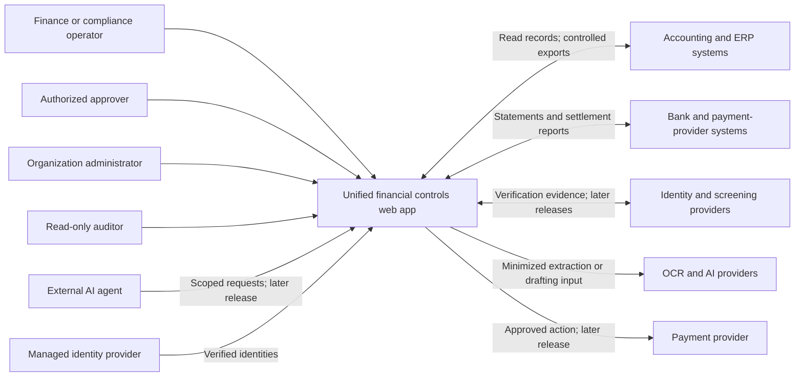
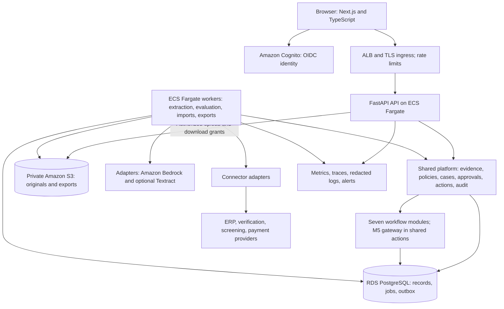

# System architecture and high-level design

Planning blueprint · 9 October 2026 · Proposed architecture, not an implemented system

## 1. Design premise

Build one B2B web application that helps financial teams validate evidence, enforce policies, review exceptions, and control consequential actions. Eight workflow modules share the same control foundation. Each module has its own domain rules, evidence requirements, specialist integrations, and release gate.

The first release serves finance operations teams: invoice review, one-to-one reconciliation, and simulated payment controls. AML investigation, chargebacks, underwriting evidence review, collections communication review, and KYC/KYB are expansion modules. India-first, a small engineering team, modest pilot volumes, and organization customers are planning assumptions to validate. Each organization represents one legal entity initially; development fixtures include at least two synthetic organizations to exercise isolation.

In simple words: the platform receives records, checks them, explains problems, asks the right person to review them, and remembers the evidence behind every decision.

**Boundary:** this platform is initially an evidence and control layer. The customer's accounting system remains the accounting source of truth, financial institutions and payment providers remain responsible for moving funds, and authorized specialists remain responsible for regulated decisions. A platform recommendation is not proof of regulatory compliance.

## 2. System context



External providers are trust boundaries. Their results require freshness, identity, provenance, and error checks. A request timeout is not evidence that an external action failed.

## 3. Container architecture

Start with a **modular monolith**: a backend organized into well-separated modules, deployed as an API process and independently scalable worker processes from the same codebase. This gives transaction consistency and a smaller operating burden than eight separate services. Separate the frontend from the backend because their scaling and deployment needs differ.



The API acknowledges long-running work after recording a durable job. Workers claim jobs with leases, retry transient failures, and record results. Financial workflows must not depend on an in-process task surviving an API restart. FastAPI documents its lightweight background-task mechanism and suggests separate tooling for larger work; our durable-job choice is a design decision for recoverability. [FastAPI background tasks](https://fastapi.tiangolo.com/tutorial/background-tasks/)

Initial deployment: one web service, one API service, one worker service, managed PostgreSQL, private object storage, managed identity, and a secrets store. The selected pilot cloud is AWS, mapped below. Kafka, Kubernetes, a vector database, and a separate policy service are unnecessary for the initial product.

### Proposed AWS deployment mapping

| Concern | Default choice | Configuration intent |
|---|---|---|
| Web/API/workers | ECS Fargate; images in ECR | Separate services; bounded CPU/memory; health checks; graceful shutdown and job leases |
| Ingress | Application Load Balancer and TLS certificates | HTTPS; route web/API; explicit application rate limits; evaluate WAF before customer exposure |
| Database | RDS for PostgreSQL | Private subnets, encryption, backups, tested restore; select supported engine/version at implementation |
| Documents/exports | Private S3 buckets | Block public access, encryption, authorized short-lived access, version/retention lifecycle |
| Authentication | Cognito through OIDC | MFA for privileged users; backend validates token issuer/audience and membership separately |
| AI | Bedrock through a narrow provider adapter | Versioned prompts/model IDs, bounded structured responses, minimum required data |
| OCR | Local pypdf and Tesseract first; optional Textract adapter | Preserve page/field locations and verification status; benchmark before choosing paid OCR |
| Secrets/keys | Secrets Manager and KMS | Distinct runtime roles, scoped secret/key access, planned rotation |
| Operations | CloudWatch plus OpenTelemetry instrumentation | Redacted logs, explicit retention, latency/queue/cost alerts |
| Local development | Docker Compose | Web, API, worker and PostgreSQL; local storage adapter; synthetic data; fake providers |

`ap-south-1` is the proposed primary region, not a verified guarantee that every chosen model and OCR feature is available there. Before using real data, verify service/model availability, the exact Bedrock inference profile, provider processing destinations, storage and backup locations, and customer requirements. Bedrock cross-region inference can route requests across regions; do not enable it implicitly. Hosting the app in India alone does not establish compliance. [Bedrock cross-region inference](https://docs.aws.amazon.com/bedrock/latest/userguide/cross-region-inference.html)

Run tasks and the database in private subnets behind controlled ingress. Select the outbound design explicitly: required VPC endpoints where supported, and controlled egress for external providers. Private Fargate networking does not automatically provide internet access; routing and endpoints must support image pulls, logs, secrets, and provider calls. [Fargate networking](https://docs.aws.amazon.com/AmazonECS/latest/developerguide/fargate-task-networking.html)

Keep the ECS execution role for runtime operations distinct from each application's task role. The API needs different S3/secret permissions from extraction workers and any future payment executor. [ECS task roles](https://docs.aws.amazon.com/AmazonECS/latest/developerguide/task-iam-roles.html)

For a customer pilot with availability commitments, consider a Multi-AZ RDS instance and multiple API tasks. A single-standby Multi-AZ RDS instance adds a standby for availability; that standby is not a read-scaling endpoint. A development database can accept a lower availability profile without promising the production target. [RDS Multi-AZ instances](https://docs.aws.amazon.com/AmazonRDS/latest/UserGuide/Concepts.MultiAZSingleStandby.html)

Budget for continuously running task/database capacity, standby capacity, the load balancer, NAT or endpoint networking, backups, document versions, log retention, OCR pages, model usage, verification calls, and data transfer. S3 storage is only one part of object cost; requests, retrieval, and management features can also contribute. This is a list of cost drivers, not a price estimate. [S3 pricing dimensions](https://aws.amazon.com/s3/pricing/)

Use S3 Block Public Access, narrowly scoped IAM/bucket policies, encryption, and short-lived authorized access. Object versions and retention policies must be explicitly managed so recoverability does not become uncontrolled storage growth. [S3 security practices](https://docs.aws.amazon.com/AmazonS3/latest/userguide/security-best-practices.html)

## 4. Shared platform responsibilities

| Capability | Responsibility | Output or guarantee within its scope |
|---|---|---|
| Organization and identity | Membership, role, module entitlement, service-account scopes, MFA/SSO configuration | Every request has a verified actor and authorized organization |
| Ingestion | Uploads, connector imports, schema validation, deduplication, provenance | Preserved original records plus versioned normalized records |
| Evidence | Document references, field coordinates, source rows, provider responses, freshness | A reviewer can trace a finding to the input supporting it |
| Policy evaluation | Run versioned deterministic rules over a frozen input set | Reproducible findings and an explicit control outcome |
| Case management | Ownership, queues, comments, requests for information, deadlines | One review history for a specific workflow |
| Approval | Required roles, thresholds, independent reviewer checks, expiry | Approval bound to the exact version of the proposed action |
| Action control | Freeze server-created proposals; recheck authorization and freshness; reserve limits; call allowed adapters | M5's gateway and other modules' consequential actions use one controlled execution path |
| Audit | Actor, object, event, reason, timestamp, evidence/policy versions | Traceability and export; restricted modification rights |
| AI gateway | Provider routing, redaction, structured output, cost limits, output validation | AI suggestions with recorded provenance and bounded capabilities |
| Integrations | Scoped credentials, provider-specific mappings, webhook validation, retries | External interaction has a durable identity and recoverable state |

One common vocabulary does not mean one global risk score. A duplicate invoice, possible screening match, and unsupported collection promise have different meanings. Preserve module-specific findings and aggregate them into `PASS`, `REVIEW`, `BLOCK`, or `INDETERMINATE` for the requested workflow.

## 5. Module boundaries

| Module | Inputs | Domain checks | Output | Release boundary |
|---|---|---|---|---|
| Invoice/payment preflight | Invoice, vendor version, purchase order, payment history | Duplicate candidates; arithmetic; currency; approved beneficiary; missing PO evidence | Findings, supporting records, review case | First release; exact rules first, fuzzy candidates reviewed |
| Reconciliation | Bank/processor/ledger imports, mapping rules, settlement periods | Exact identifiers, equal amounts and currency; duplicate rows; unsupported-case detection | One-to-one match proposals and exception cases | First release supports one-to-one only; split/partial/fee/refund/FX cases route to review; approved export before accounting write-back |
| AML investigation | Existing alerts, transaction history, customer information, screening evidence | Evidence completeness; timeline consistency; source freshness; claims supported by records | Evidence bundle and draft case narrative | Expansion; no autonomous suspicious-activity filing |
| Chargebacks | Dispute details, order, delivery, refund, support records | Evidence required for the dispute type; contradictions; deadline; personal-data minimization | Reviewable response package | Expansion; provider-specific submission approval |
| Agent payment gateway | Signed/scoped request, action amount, beneficiary, delegated budget | Actor scope; mandate; allowed recipient; reserved spend; duplicate action; approval freshness | Denial, review request, or execution authorization | M5 lives in shared actions; simulation first; live connector is a separate release gate |
| Underwriting evidence | Application, income records, verified data, lender policy | Recomputed ratios; conflicting figures; missing evidence; unsupported reasons | Evidence assessment and policy exceptions | Expansion; no unvalidated credit-scoring claim |
| Collections communication QA | Draft message, account facts, approved offers and communication policies | Correct balance; allowed offer; appropriate language; hardship routing; permitted channel/timing | Findings and reviewed message | Expansion; no automatic sending by default |
| KYC/KYB review | Submitted records, beneficial-owner evidence, trusted verification/screening results | Completeness; expiry; contradictions; provider result freshness; unresolved matches | Evidence summary and reviewer queue | Expansion; document summaries are not identity authentication |

Each workflow module exposes a standard evaluation interface while owning its domain tables and validators. M5 is the shared `actions/` gateway used by those workflows, not a second payment-execution module. Modules call each other through application services or committed events, rather than updating each other's tables directly. The common repository layout uses `apps/web`, `apps/api`, and `apps/worker` with shared business code in `backend/`; the low-level design and implementation plan use the same layout.

## 6. Main data flow

1. **Receive:** authorize the actor, accept an invoice or import, compute a content hash, and store the original privately.
2. **Extract:** run safe parsing/OCR. Treat all extracted text as untrusted data, including instructions embedded in documents.
3. **Normalize:** parse dates, currencies, decimal quantities, vendor identifiers, and document references. Keep raw and normalized values separately.
4. **Verify:** a reviewer corrects uncertain critical fields. Version the correction instead of overwriting its origin.
5. **Snapshot:** freeze the relevant input versions, vendor/beneficiary versions, policy version, and rule-engine version in a consistent database transaction. Verify the chosen source revisions have not changed before saving the decision.
6. **Evaluate:** deterministic checks create findings; AI can explain the already established findings or propose candidates.
7. **Review:** display original evidence, findings, missing information, and the available next action.
8. **Propose:** accept proposed action fields through `POST /v1/action-proposals`; the server validates and freezes the complete payload, computes its canonical digest, and evaluates action-specific controls. Client-supplied digests are not trusted.
9. **Approve:** create an approval request referencing the server-created proposal ID; apply role/threshold requirements and independent-review constraints to that exact proposal and its action evaluation.
10. **Create intent:** after approvals are complete, create one durable execution intent referencing the approved proposal. The caller cannot substitute new action fields.
11. **Execute or export:** recheck dynamic constraints immediately before action. In the first release, simulate a payment or create an approved export.
12. **Reconcile and retain:** ingest the outcome, resolve the case, and preserve the audit/evidence bundle under the customer's retention policy.

```mermaid
sequenceDiagram
    actor Maker as Finance operator
    participant Web as Web app
    participant API as API
    participant DB as PostgreSQL
    participant W as Worker
    participant AI as OCR / AI
    actor Checker as Independent reviewer
    Maker->>Web: Upload invoice and select vendor
    Web->>API: Submit stored document reference
    API->>DB: Save case, document version and extraction job
    API-->>Web: Accepted with case ID
    W->>DB: Claim extraction job
    W->>AI: Extract bounded structured fields
    AI-->>W: Candidate values and source locations
    W->>DB: Save extraction; create verification task
    Checker->>API: Confirm or correct critical fields
    API->>DB: Freeze inputs and enqueue evaluation
    W->>DB: Load snapshot and policy
    W->>W: Calculate totals and run rules
    W->>DB: Save immutable decision and findings
    Maker->>API: Create action proposal with amount and beneficiary
    API->>DB: Validate and freeze proposal; compute server digest
    W->>DB: Save action preflight evaluation bound to proposal
    Maker->>API: Request approval by proposal ID
    Checker->>API: Review evidence; approve exact stored proposal
    API->>DB: Check role separation and save approval
    Maker->>API: Create intent from approved proposal
    API->>DB: Persist intent without accepting replacement action fields
    W->>DB: Recheck current versions; simulate approved payment
    Web->>API: Fetch outcome and audit history
```

A production policy may allow the maker to correct extraction fields and require a separate person only at final approval. The diagram shows the conservative pilot setting. These are explicit organization policies, not assumptions inferred by the model.

## 7. AI and deterministic boundaries

| AI can assist with | Deterministic application code must control |
|---|---|
| Reading varied document layouts | Currency precision, totals, fees, and amount conservation |
| Suggesting possible transaction matches | Whether a match consumes an amount already allocated elsewhere |
| Drafting evidence-based explanations | Policy outcome, approval requirements, and executable state |
| Organizing an investigation timeline | Actor permissions, tenant isolation, evidence retention, and allowed tools |
| Highlighting ambiguous language | Payment limits, idempotency, beneficiary versions, and execution eligibility |

The model receives no payment credentials and cannot bypass application services. Its output is validated against a schema, attributed to sources, and marked as a suggestion. Missing evidence produces an unresolved result. A high model confidence score never substitutes for an authoritative source or approval.

Do not make an LLM call part of a database transaction. A model outage may delay explanation or extraction; it must not silently turn an unresolved check into a pass. Deterministic checks can continue when their verified inputs are available.

## 8. Data, isolation, and security design

Use `organization_id` on every tenant-owned row, composite tenant-aware foreign keys, organization-scoped storage keys, and authorization checks on every API operation. PostgreSQL row-level security is an additional database boundary. App and worker roles must not be superusers, table owners, or roles with `BYPASSRLS`; use `FORCE ROW LEVEL SECURITY` where appropriate. These bypass behaviors are documented by PostgreSQL. [PostgreSQL row security](https://www.postgresql.org/docs/current/ddl-rowsecurity.html)

Tenant context is derived from a verified identity plus server-checked membership. Set it transaction-locally, not from an unchecked request header. Reset pooled connections and test cross-tenant access through APIs, background jobs, exports, signed download URLs, and search. Tenant context in a session variable does not protect against a fully compromised trusted application; parameterized queries, least privilege, and infrastructure controls remain necessary.

Store raw documents in encrypted private object storage. Store object references, hashes, and searchable metadata in PostgreSQL. Use short-lived authorized downloads, malware/file-size checks, a secrets manager, key rotation, and redacted logs. Do not send an entire customer dataset to a model for a single-field extraction.

Audit records are append-only for ordinary application roles. This is not absolute immutability against a database administrator. Stronger production requirements may require retention-locked exports, an independent audit sink, and tested recovery. Retention, legal holds, deletion, and backups must be designed together for each customer and workflow.

## 9. Reliability and transaction design

- Save a business state change and its outbox event in one PostgreSQL transaction. Publish or process it asynchronously. Assume duplicate delivery and make consumers idempotent.
- Use short row locks for approvals, allocation changes, spending reservations, and execution claims. Use a fixed lock order and bounded retries. Do not hold database locks across provider calls.
- Keep external action state distinct from internal approval state. `APPROVED` does not mean paid; `SUBMITTED` does not mean settled; `UNKNOWN` does not mean failed.
- Enforce duplicate prevention internally and use the provider's stable idempotency mechanism when supported. Provider guarantees differ. For example, Stripe documents storage and replay behavior for its idempotency keys; an adapter must follow its specific provider contract. [Stripe idempotent requests](https://docs.stripe.com/api/idempotent_requests)
- Verify webhook signatures, record each provider event once, tolerate repeated and out-of-order events, and verify transitions against the provider's authoritative status when necessary. Stripe explicitly documents duplicate events and lack of event ordering. [Stripe webhooks](https://docs.stripe.com/webhooks)
- A corrected invoice, changed beneficiary, revised policy, expired approval, revoked role, or changed amount requires reevaluation before execution. Preserve the old decision as history.

PostgreSQL supports stronger transaction isolation when a workflow needs a consistent concurrent decision; serialization failures require retrying the entire transaction. Choose isolation deliberately for financial state changes rather than assuming default queries prevent races. [PostgreSQL transaction isolation](https://www.postgresql.org/docs/current/transaction-iso.html)

## 10. Proposed pilot targets

These are engineering targets for test design, not measured performance or customer commitments. Baseline hardware, test data, provider latency, and staffing must be recorded before acceptance.

| Area | Initial planning target |
|---|---|
| Pilot load | 5 organizations; 50 concurrent users; 1,000 short invoices/day; 100,000 reconciliation rows per import |
| Interactive requests | p95 under 500 ms for ordinary API reads/writes excluding upload, queue delay, AI, and external providers |
| Document evaluation | p95 under 60 seconds after upload for supported short documents under the defined pilot workload; expose progress and backlog |
| Critical controls | All defined release-gate tests pass; no known cross-tenant access or duplicate execution failure |
| Recovery | Before a live pilot, demonstrate restore to a documented recovery point; initial planning targets RPO 15 minutes / RTO 4 hours, subject to selected infrastructure |
| Availability | Aim for 99.5% monthly pilot availability; do not sell an SLA until operations demonstrate it |
| Auditability | Every approval and action has an actor, input version, policy version, decision reference, and reason |

Track queue age, worker retries, processing duration, connector health, missing evidence, false holds, reviewer overrides, extraction corrections, cost per evaluated case, and unresolved payment states. Keep operational metrics distinct from evidence that the product saves customers time or money.

## 11. Evolution and decision gates

**Prototype:** synthetic data, local containers, at least two organizations for isolation tests, one legal entity per organization, exact checks, one-to-one reconciliation, and simulated actions. Split/partial payments, fees, refunds, and FX examples exercise exception routing rather than automatic matching.

**Pilot:** tenant isolation, managed identity, durable jobs, restore testing, read-only integrations, evidence exports, and customer-specific policy configuration.

**Commercial finance product:** production support, customer onboarding, scoped connectors, usage metering, accounting exports, approved write-back where validated, and contracted data handling.

**Specialist modules:** add one domain at a time with a domain expert, representative labelled cases, appropriate providers, and explicit approval responsibilities.

**Live payment controls:** only after provider integration, concurrent-limit tests, status-recovery drills, security review, customer authority, and the applicable business/regulatory model have been established. Do not add wallet custody merely to demonstrate payment guardrails.

Split a component into a service when measured load, fault isolation, independent deployment, or customer data boundaries justify it. Likely first candidates are document processing and live action execution. Add a workflow engine or message broker only when the DB job system's operational limits are demonstrated.

## 12. Architecture decisions and risks

| Decision | Reason | Tradeoff or review trigger |
|---|---|---|
| Modular monolith | Fewer moving parts, shared transactions, faster first release | Require module ownership and import boundaries to avoid tangled code |
| PostgreSQL jobs/outbox initially | Durable work and atomic state changes with one data service | Monitor queue contention and backlog; split metadata-only dispatch from tenant payload access |
| Human approval for consequential first-release actions | Produces a reviewable pilot and labelled feedback | Adds review time; measure whether the workflow still saves effort |
| Rule engine before custom models | Explainable exact controls are easier to test | Rules need ownership, versioning, and careful exception handling |
| Provider-based identity/screening verification | Specialist evidence has requirements beyond document summarization | Cost, availability, coverage, customer authorization, and data contracts |
| CSV imports before many connectors | Rapid onboarding and visible data mappings | Stale data must be visible; a CSV cannot authorize a live payment by itself |

The largest design risks are incorrect source data, stale approvals, overbroad tenant access, silent external-action ambiguity, and rules that overwhelm users with false holds. The architecture makes those risks visible and testable; it cannot eliminate them by adding an AI prompt.
