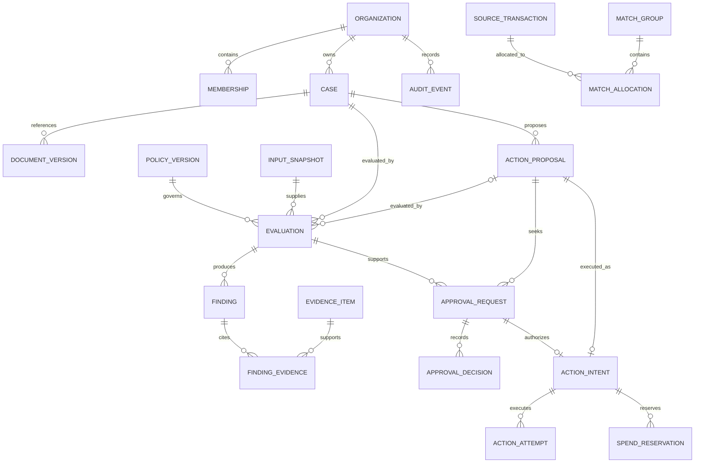
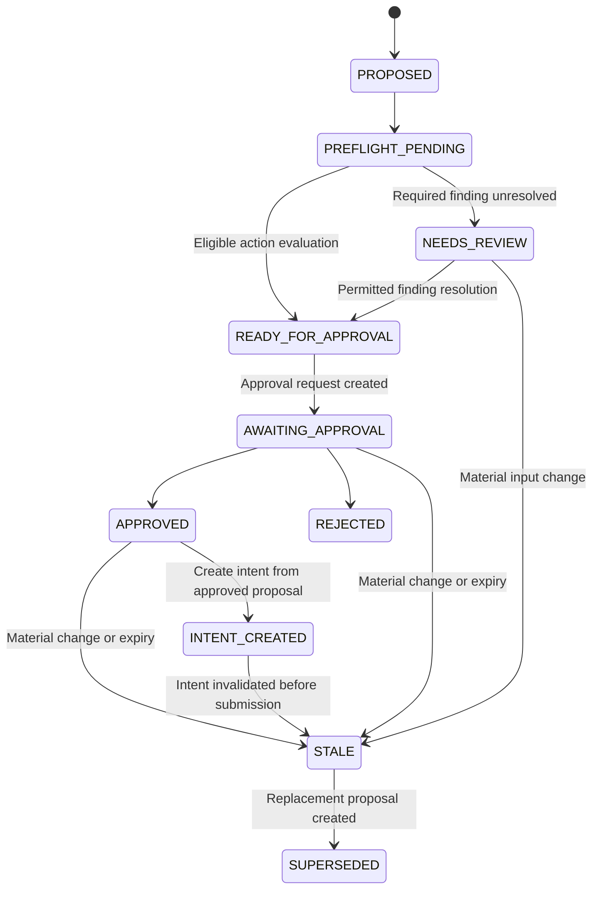
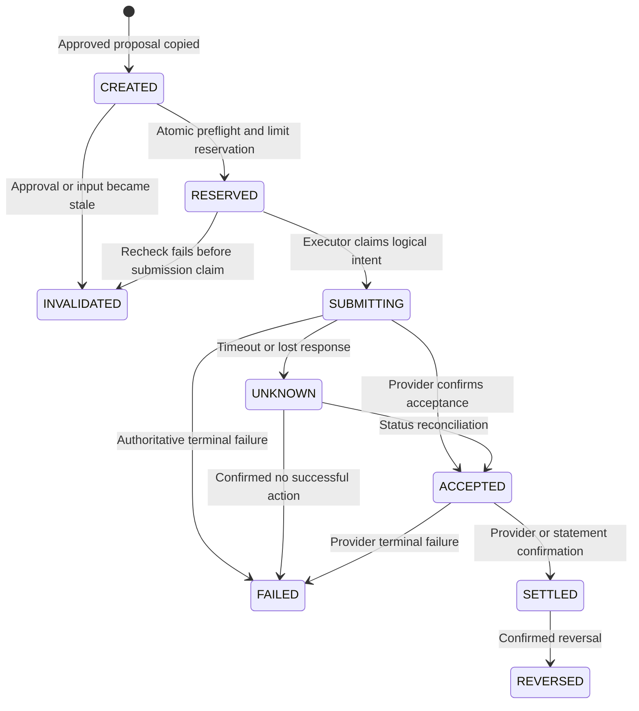

# Low-level design and implementation contracts

Planning blueprint · 9 October 2026 · Interfaces and SQL are illustrative design material, not deployed code

## 1. Repository structure and module contract

```text
finguard/
  apps/
    web/                         # Next.js application
    api/                         # FastAPI entry point
    worker/                      # Worker entry point, same Python package
  backend/
    identity/                    # Membership, roles, entity scope
    evidence/                    # Documents, imports, source references
    cases/                       # Review lifecycle, assignments
    policies/                    # Versioned rules and evaluators
    approvals/                   # Payload-bound approvals
    actions/                     # M5 gateway, controlled execution and simulator
    modules/
      invoices/
      reconciliation/
      aml/
      chargebacks/
      underwriting/
      communications/
      kyc/
    adapters/                    # Integration adapters and webhook validation
      object_store/
      oidc/
      ocr/
      models/
      payments/
    persistence/                 # SQLAlchemy, unit of work, jobs and outbox
    telemetry/                   # Redacted observability and audit interfaces
  contracts/                     # Generated OpenAPI/client artifacts
  migrations/                    # Alembic
  tests/
    unit/
    integration/
    isolation/
    workflow/
    evaluations/
  fixtures/synthetic/
  infrastructure/
  docs/
```

Every workflow module implements `validate_inputs`, `build_snapshot`, `evaluate`, and `render_findings`. Modules return structured facts and findings; presentation and notifications belong to the shared platform. M5's payment gateway lives in shared `backend/actions/`, not a duplicate domain module; `backend/adapters/payments/` contains provider-specific transport only. Business code receives repositories through a unit of work. Route handlers do not directly mutate financial tables.

Cloud-specific code stays inside adapters. The selected pilot adapters are S3 for objects, Cognito for OIDC identities, Bedrock for AI, and optionally Textract for OCR; API and workers run on ECS Fargate with RDS PostgreSQL. Local development uses pypdf/Tesseract, local storage, and fake provider adapters with the same contracts. No deployment or provider connection has been performed by this design document.

```python
class ModuleEvaluator(Protocol):
    def validate_inputs(self, inputs: NormalizedInputs) -> ValidationReport: ...
    def evaluate(
        self,
        snapshot: EvaluationSnapshot,
        policy: PublishedPolicyVersion,
    ) -> EvaluationResult: ...

class ActionAdapter(Protocol):
    async def submit(self, request: FrozenAction, idempotency_key: str) -> SubmitResult: ...
    async def status(self, provider_reference: str) -> ProviderStatus: ...
```

`evaluate` has no external side effects. External data is fetched and recorded before constructing its snapshot. The action adapter is called only by an authorized executor after a separate preflight.

## 2. Domain primitives and invariants

**Money:** store payable/settled amounts as signed `BIGINT` minor units plus an ISO currency code; store the currency exponent used for interpretation. ₹10,000 is `1000000` minor units for INR. API JSON represents large integer amounts as strings to avoid JavaScript precision loss. Use decimal types for quantities, unit prices, tax rates, and FX rates; quantize once according to explicit currency/rounding rules. Do not use binary floating point for financial arithmetic. PostgreSQL distinguishes exact integer/numeric types from approximate floating-point types. [PostgreSQL numeric types](https://www.postgresql.org/docs/current/datatype-numeric.html)

**Identifiers:** use UUIDs for internal object IDs, tenant-scoped external IDs for imported records, normalized candidate keys for matching, and source IDs for traceability. A normalized invoice number is a matching aid, not sufficient proof of identity.

**Time:** use timezone-aware UTC timestamps for system events; preserve source timezone and local business date where relevant. A spending window is explicitly defined using the organization's configured timezone.

**Version:** every mutable business aggregate has an integer `revision`. Changes that affect evaluation create a new immutable input version. Current aggregate pointers may change; historical versions do not.

**Finding:** `rule_code`, `rule_version`, `result`, `severity`, `reason_code`, `message`, `evidence_refs`, `observed_values`, `expected_values`, and `requires_review`.

**Rule result:** `PASS`, `FAIL`, `UNKNOWN`, or `NOT_APPLICABLE`. Missing required evidence is `UNKNOWN`, not `PASS`.

**Overall decision:** `PASS`, `REVIEW`, `BLOCK`, or `INDETERMINATE`. A `PASS` says the selected checks passed on the frozen inputs; it does not itself authorize an action.

**Critical invariants:**

1. A tenant-owned child can reference only a parent in the same tenant.
2. A decision references immutable input, policy, rule-engine, and evidence versions.
3. An approval references one action evaluation and one immutable, server-created action proposal; its canonical digest is computed by the server. An execution intent is created only after the required approvals.
4. A maker cannot approve their own action where independent approval is required.
5. Material input changes invalidate action eligibility until reevaluation and required reapproval.
6. One logical action has one stable execution identity across retries.
7. An unknown external result holds the reservation and cannot produce a fresh transfer.
8. Allocated reconciliation amounts cannot exceed source amounts under the relevant sign/currency convention.
9. Audit and decision history cannot be edited through ordinary application roles.
10. No AI-generated text can directly change a policy, grant a role, or execute a payment.

## 3. Logical data model



| Table / aggregate | Key fields beyond IDs and tenant | Constraints and purpose |
|---|---|---|
| `organization` | name, legal_entity_reference, timezone, status, settings_revision | One legal entity per tenant initially; fixtures contain at least two tenants for isolation tests |
| `membership` | identity_subject, role, status, authorization_revision | Unique `(organization_id, identity_subject)`; permission changes audited |
| `service_account` | credential_reference, scopes, expires_at, revoked_at | Machine actor, never a human approver |
| `case` | module, status, owner_id, subject_id, revision, due_at | `(organization_id, status, updated_at)` queue index |
| `document_version` | object_key, sha256, media_type, size, original_name, malware_status | Append-only version; download requires tenant authorization |
| `evidence_item` | source_type, source_ref, version, locator, observed_at, valid_until, integrity_hash | Locator can identify a page rectangle, CSV row, or JSON path |
| `vendor_version` / `beneficiary_version` | parent_id, revision, encrypted_details, verification_status, verifier_id | A changed bank account creates a new beneficiary version |
| `invoice_version` / `invoice_line` | vendor_version_id, invoice_number_raw/normalized, currency, total_minor, source_document_id | Preserve duplicates as cases; use a candidate-key index rather than silently discarding them |
| `policy_version` | policy_id, version, module, rules_json, digest, lifecycle, publisher_id | Published versions immutable; author and publisher separable |
| `input_snapshot` | schema_version, canonical_inputs_json, digest, source_revision_map | Sensitive content minimized; exact evaluation inputs preserved |
| `evaluation` | case_id, proposal_id nullable, snapshot_id, policy_version_id, engine_version, result, coverage_json | No updates to completed evaluation content; action evaluations reference an exact proposal |
| `finding` / `finding_evidence` | evaluation_id, rule_code, result, reason_code, values_json; evidence_item_id | Tenant-aware references; support multiple evidence items per claim |
| `finding_resolution` | finding_id, actor_id, resolution_code, reason, evidence_refs, expires_at | Append-only disposition for reviewable findings; never rewrites the original result |
| `action_proposal` | case_id, maker_id, action_type, canonical_payload_json, digest, source_revision_map, mode, state | Server-validated frozen payload/digest; changed fields require a new proposal |
| `approval_request` | proposal_id, evaluation_id, action_digest, policy_requirements_json, expires_at, state | Proposal digest copied server-side; snapshot required roles/counts/limits for reviewer display |
| `approval_decision` | request_id, actor_id, role_at_decision, decision, reason, decided_at | Unique reviewer decision per request; append revocation separately |
| `action_intent` | proposal_id, evaluation_id, approval_request_id, action_digest, state, mode | Created only after approvals; action fields come from frozen proposal; unique logical operation and proposal execution identity |
| `action_attempt` | intent_id, attempt_number, provider_idempotency_key, request_digest, provider_ref, outcome | Stable provider key for same logical intent; sanitized response reference |
| `spend_bucket` / `spend_reservation` | scope, currency, window; intent_id, amount_minor, state | Lock bucket before checking committed plus reserved spend |
| `import_batch` / `source_transaction` | connector, external_id, payload_hash, booked_at, amount_minor, currency | Unique provider/tenant/external record; conflicting updates are versioned |
| `match_group` / `match_allocation` | version, state; source_transaction_id, side, allocated_minor | First release enforces one-to-one full-amount matching; schema permits later validated N-to-M extension |
| `job` / `outbox_event` | type, object_ref, available_at, attempts, lease_token, lease_until, state | At-least-once processing; payloads hold references where possible |
| `webhook_receipt` | connector_id, provider_event_id, received_at, payload_hash, processing_state | Unique `(organization_id, connector_id, provider_event_id)` |
| `idempotency_record` | actor_scope, route, key, request_digest, response_ref, state | Unique tenant/scope/route/key; conflicting body returns `409` |
| `audit_event` | actor, action, object_ref, timestamp, reason, trace_id, change_digest | Insert-only runtime grant; redact personal data from generic log fields |

Module expansion tables include `investigation`, `dispute_package`, `loan_evidence_assessment`, `communication_review`, and `identity_review`. They reference shared cases/evidence and retain their specific fields; avoid placing all domain data in an unvalidated generic JSON blob.

## 4. Tenant-safe SQL pattern

Illustrative migration pattern for one table pair:

```sql
CREATE TABLE case_record (
    organization_id uuid NOT NULL,
    id uuid NOT NULL,
    module text NOT NULL,
    status text NOT NULL,
    revision bigint NOT NULL DEFAULT 1 CHECK (revision > 0),
    created_at timestamptz NOT NULL DEFAULT now(),
    updated_at timestamptz NOT NULL DEFAULT now(),
    PRIMARY KEY (organization_id, id)
);

CREATE TABLE evaluation_record (
    organization_id uuid NOT NULL,
    id uuid NOT NULL,
    case_id uuid NOT NULL,
    input_digest text NOT NULL,
    policy_digest text NOT NULL,
    result text NOT NULL CHECK
      (result IN ('PASS', 'REVIEW', 'BLOCK', 'INDETERMINATE')),
    created_at timestamptz NOT NULL DEFAULT now(),
    PRIMARY KEY (organization_id, id),
    FOREIGN KEY (organization_id, case_id)
      REFERENCES case_record (organization_id, id)
);

CREATE INDEX evaluation_case_idx
    ON evaluation_record (organization_id, case_id, created_at DESC);

ALTER TABLE case_record ENABLE ROW LEVEL SECURITY;
ALTER TABLE case_record FORCE ROW LEVEL SECURITY;
CREATE POLICY case_tenant_access ON case_record TO app_runtime
    USING (organization_id =
      nullif(current_setting('app.organization_id', true), '')::uuid)
    WITH CHECK (organization_id =
      nullif(current_setting('app.organization_id', true), '')::uuid);

-- Apply equivalent policies to every tenant-owned table.
-- app_runtime is a non-owner role without BYPASSRLS or DDL rights.
```

The backend calls parameterized `set_config('app.organization_id', verified_org_id, true)` inside each transaction. The third argument makes context local to the transaction. Membership and endpoint permissions are checked before use. RLS enforces organization boundaries; fine-grained module/field permissions still need application authorization or additional database roles/views. Test all access paths with the real runtime role. PostgreSQL documents default-deny behavior and owner/superuser bypass considerations. [PostgreSQL row security](https://www.postgresql.org/docs/current/ddl-rowsecurity.html)

Grant only required table operations. Migration credentials are distinct from runtime credentials. No direct browser SQL or exposed database credentials. Keep separate narrow capabilities for job dispatch, extraction, and future live payment execution. A dispatcher that scans organizations sees job metadata only; the worker loads payloads within the job's verified tenant context.

Index tenant IDs followed by actual filter/join columns. Add indexes to referencing foreign-key columns where query/delete behavior warrants them. Use cursor pagination on `(created_at, id)` for large queues. Set bounded pools for API and worker processes and respect the database's connection budget.

## 5. Policy representation and outcome aggregation

Initially implement a registry of reviewed rule functions and a typed declarative configuration, validated with strict Pydantic models and explicit value bounds. Do not let customers submit Python, JavaScript, arbitrary SQL, or unchecked expressions for execution. Policy validation rejects unknown fields/rules, negative tolerances or limits, unsupported currencies, and approval settings outside the organization's allowed authority model.

```json
{
  "schema_version": 1,
  "policy_code": "invoice-preflight",
  "version": 3,
  "module": "invoices",
  "rules": [
    {"code": "invoice.total_matches_lines", "version": 1,
     "parameters": {"tolerance_minor": "0"}, "on_fail": "BLOCK"},
    {"code": "invoice.duplicate_candidate", "version": 1,
     "parameters": {"match_fields": ["vendor", "invoice_number", "currency"]},
     "on_fail": "REVIEW"},
    {"code": "beneficiary.is_verified", "version": 1,
     "parameters": {}, "on_fail": "BLOCK", "on_unknown": "INDETERMINATE"}
  ],
  "approval": {"required_role": "finance_approver", "count": 1,
               "maker_can_approve": false, "expiry_minutes": 120}
}
```

Amounts, expiry, and reviewer counts are example settings, not recommended universal limits. Configure and validate them with the customer.

Evaluation order:

1. Validate policy schema and availability of every rule/version.
2. Build canonical input JSON and digest including currency, amount, document versions, beneficiary version, and source cutoffs.
3. Execute deterministic rules. Catch a rule crash as an evaluation error, not a pass.
4. Aggregate: a blocking failure yields `BLOCK`; otherwise unresolved required evidence yields `INDETERMINATE`; otherwise review findings yield `REVIEW`; otherwise `PASS`.
5. Save all individual findings, coverage, and an immutable decision record in one transaction with an audit event.
6. Optionally produce an AI explanation using only saved findings and their evidence. An explanation error does not change the policy outcome.

Disposition rules are explicit: `BLOCK` findings are not overridden in the first release; the source problem or policy must be corrected through its authorized process and reevaluated. `INDETERMINATE` requires new evidence and a new evaluation. `REVIEW` findings may receive a permitted, reasoned `finding_resolution` from the required reviewer, such as confirming that a duplicate candidate is a legitimate recurring invoice. Preserve the original finding and its resolution separately. Execution eligibility combines the frozen evaluation, valid resolutions, current controls, and required approvals; it never changes the historical result to manufacture a pass.

Policy lifecycle: `DRAFT → VALIDATED → PUBLISHED → RETIRED`. Publishing creates a new immutable version, needs the required publisher permission, and runs regression scenarios. Existing unexecuted actions affected by a new required policy version are reevaluated. Emergency blocklists and revoked permissions apply immediately at execution preflight.

## 6. API contracts

Use versioned REST endpoints, an OpenAPI-generated TypeScript client, cursor pagination, structured errors, and trace IDs. Organization selection is resolved to server-verified membership. Never trust an arbitrary `organization_id` in a request body.

| Endpoint | Main request | Response and behavior |
|---|---|---|
| `POST /v1/uploads` | filename, content type, size, declared hash | `201`: document ID and short-lived upload grant |
| `POST /v1/uploads/{id}/complete` | uploaded object reference | `202`: verification/extraction job ID; verify actual object metadata |
| `POST /v1/invoices` | document ID, selected vendor ID | `201`: case and invoice draft; idempotent |
| `PATCH /v1/invoices/{id}` | verified field corrections; expected revision | `200`: new revision; `409` for stale edits |
| `POST /v1/cases/{id}/evaluations` | expected revision | `202`: evaluation job and snapshot reference |
| `GET /v1/cases/{id}` | — | Case, current findings, source references, allowed next actions |
| `POST /v1/action-proposals` | case ID, expected case revision, action type, amount/currency, beneficiary version, purpose, source references, `mode` | `201`: server-validated frozen proposal ID/digest and queued action-preflight evaluation; first release permits only `SIMULATED` payment proposals |
| `POST /v1/approval-requests` | proposal ID | `201`: server-selected eligible action evaluation, required reviewers and expiry; `409` if preflight is pending/stale/unresolved |
| `POST /v1/approval-requests/{id}/decisions` | approve/reject, reason, expected revision | `201`: immutable reviewer decision; separation checks enforced |
| `POST /v1/action-intents` | proposal ID, completed approval-request ID | `202`: durable intent created after approval checks; payload and mode copied from proposal; replacement action fields rejected |
| `GET /v1/action-intents/{id}` | — | Approval, execution, provider, and reconciliation states separately |
| `POST /v1/reconciliation/imports` | document/import IDs and validated mapping | `202`: import job |
| `POST /v1/reconciliation/matches/{id}/approve` | expected version, reason | `200`: approved one-to-one match after equal-amount/currency and allocation recheck; unsupported match forms route to review |
| `POST /v1/policies/{id}/publish` | validated draft ID, reason | `201`: immutable published version |
| `POST /v1/audit-exports` | case IDs/time range and purpose | `202`: scoped export job; authorized expiring download |
| `POST /v1/webhooks/{connector}` | raw provider payload | Verify signature and connector binding; persist/deduplicate before processing |

Every retriable mutation accepts `Idempotency-Key`. Same tenant/actor scope, route, key, and canonical body return the original result; the same key with another body returns `409 IDEMPOTENCY_CONFLICT`. Store in-progress operation state so concurrent identical calls converge on one operation.

The proposal endpoint treats submitted fields as requests, resolves tenant-owned source records, validates money and beneficiary versions, and serializes a canonical payload with a versioned algorithm. The server computes and stores the digest; a digest supplied by the browser is rejected as an unknown field, never used as authority. An action-preflight evaluation includes the frozen proposal and current control inputs. Approval requests resolve that evaluation from the proposal ID and bind to both. A changed amount, beneficiary, purpose, or mode requires a new proposal and approvals. Approval creation never silently substitutes a new proposal, and intent creation accepts no replacement financial fields.

```json
{
  "evaluation_id": "illustrative-uuid",
  "case_revision": 4,
  "outcome": "INDETERMINATE",
  "action_eligible": false,
  "findings": [{
    "rule_code": "beneficiary.is_verified",
    "result": "UNKNOWN",
    "reason_code": "BENEFICIARY_VERIFICATION_MISSING",
    "message": "The selected bank details do not have a current verification record.",
    "evidence_refs": ["beneficiary-version-7"]
  }],
  "next_actions": ["REQUEST_BENEFICIARY_VERIFICATION"]
}
```

Return `401` for missing authentication, `403` for insufficient permission, `404` where appropriate to avoid exposing cross-tenant object existence, `409` for revision/state conflicts, `422` for invalid inputs, and `429` for rate/cost limits. Provide stable machine-readable reason codes alongside user-facing text.

## 7. State machines

Case progress and policy outcome are separate fields. A blocked evaluation is evidence for a review case, not an irreversible declaration that a person is fraudulent.

```mermaid
stateDiagram-v2
    [*] --> RECEIVED
    RECEIVED --> EXTRACTING
    EXTRACTING --> NEEDS_INFORMATION: Missing or uncertain fields
    EXTRACTING --> READY_TO_EVALUATE: Verified required inputs
    NEEDS_INFORMATION --> READY_TO_EVALUATE: New verified version
    READY_TO_EVALUATE --> EVALUATING
    EVALUATING --> IN_REVIEW: Decision saved
    IN_REVIEW --> NEEDS_INFORMATION: Reviewer requests evidence
    IN_REVIEW --> READY_FOR_ACTION: Required approvals complete
    READY_FOR_ACTION --> IN_REVIEW: Input or policy changed; approval expires
    READY_FOR_ACTION --> ACTION_PENDING: Execution claimed
    ACTION_PENDING --> RESOLVED: Authoritative completion or approved export
    ACTION_PENDING --> IN_REVIEW: Exception or confirmed failure
    IN_REVIEW --> CLOSED: Rejected or withdrawn with reason
```



Proposal and approval lifecycle; the frozen proposal exists before an approval request:



Execution lifecycle; `CREATED` exists only after the proposal has the required approvals:



Simulation uses the same transition rules against a fake provider and is visibly labelled in the UI and audit records. An intent invalidated before submission releases its reservation only after confirming that no submission was claimed. An already claimed or ambiguous external action follows the `UNKNOWN` recovery path. Cancellation after submission is provider-dependent; a UI cancel click never implies that money movement has been stopped.

## 8. Approval and execution transaction

The initial role set is `org_admin`, `policy_author`, `policy_publisher`, `finance_operator`, `finance_approver`, `compliance_reviewer`, `auditor`, and scoped `service_account`. Roles grant distinct capabilities; being an administrator does not automatically grant payment approval. A sole-founder demo may use separate synthetic identities, but must not claim genuine separation of duties.

| Operation | Allowed actor | Additional check |
|---|---|---|
| Import/correct invoice | Finance operator | Own organization; correction reason and new version |
| Verify beneficiary | Authorized finance reviewer | Independent evidence and freshness; cannot self-approve consequential change under policy |
| Author policy | Policy author | Typed rules only; simulation required |
| Publish policy | Policy publisher | Required independent review; version and regression checks |
| Approve payment proposal | Finance approver | Exact server-stored proposal; not maker; within authority limit; current membership; MFA/step-up if required |
| Review regulated case | Compliance reviewer | Appropriate module permission and case scope |
| Execute intent | Narrow executor service | Valid approval, fresh preflight, budget reservation, scoped provider credential |
| Export evidence | Authorized reviewer/auditor | Purpose, scope, expiry, download audit |

Illustrative execution algorithm:

```text
begin short transaction
  lock action intent, relevant aggregate, and spend bucket in fixed order
  reject if intent is terminal or already claimed
  reload current membership, policy, beneficiary and invoice revisions
  load frozen server-created proposal referenced by intent and approval request
  recompute canonical digest and verify it matches proposal and approval records
  verify approval count, role limits, independence and expiry
  verify no unresolved required finding and no emergency block
  verify available limit = configured limit - committed spend - active reservations
  reserve amount and mark intent RESERVED
  append audit event and execution outbox event
commit

executor claims event with lease
persist stable provider idempotency key and request digest before network call
call provider outside database transaction
begin short transaction
  record provider response or UNKNOWN result
  update intent and reservation according to authoritative outcome
  append audit event and next reconciliation job
commit
```

Do not release a reservation on a network timeout. Never change the provider key simply because a retry is convenient. If the provider's retention window expires while the result is unknown, stop automatic resubmission and reconcile through authoritative provider records or a documented manual process. This design uses provider-specific capabilities rather than assuming all providers behave like Stripe. [Stripe idempotency contract](https://docs.stripe.com/api/idempotent_requests)

Approval is invalidated by changes to amount, currency, beneficiary, payment purpose where policy-relevant, invoice verification, required evidence, policy, or approval authority. Harmless UI metadata such as a reviewer label does not need to invalidate it. Maintain an explicit material-field list per module and test it.

Define the atomic execution claim as the authorization boundary: relevant mutations and claims acquire the same aggregate/policy-control locks, and the claimed request is frozen. Changes committed before the claim are rechecked; changes after submission trigger a provider-specific cancel/hold request if supported. An emergency stop prevents new claims and requests cancellation of in-flight work, but cannot promise reversal of an action already accepted externally. Make this boundary visible in the UI and audit history.

## 9. Durable jobs, outbox, and webhooks

Use jobs with `available_at`, `lease_until`, `lease_token`, `attempt_count`, `last_error_code`, and `max_attempts`. Claim with `FOR UPDATE SKIP LOCKED` in a short transaction. A worker completes a job only if its lease token is still current. A lease reaper returns abandoned jobs to the ready queue. Store per-tenant quotas so one large import cannot occupy every worker.

PostgreSQL documents `SKIP LOCKED` as useful for queue-like consumers while warning that it gives an inconsistent view; therefore use it for job claiming, not financial balance calculations. [PostgreSQL locking clause](https://www.postgresql.org/docs/current/sql-select.html#SQL-FOR-UPDATE-SHARE)

```json
{
  "event_id": "illustrative-uuid",
  "event_type": "evaluation.completed",
  "schema_version": 1,
  "organization_id": "illustrative-uuid",
  "aggregate_id": "illustrative-case-uuid",
  "aggregate_revision": 4,
  "occurred_at": "2026-10-09T10:00:00Z",
  "data": {"evaluation_id": "illustrative-evaluation-uuid"}
}
```

Event consumers keep a unique `(consumer_name, organization_id, event_id)` receipt or a domain-specific unique key. Outbox delivery may repeat after a crash; every downstream operation must tolerate that. External payment idempotency and unknown-state recovery remain necessary even with worker fencing because an expired worker may already have called the provider.

Webhook ingestion verifies the raw-body signature and expected connector before parsing trust-sensitive content; enforces size limits; records a unique event receipt; acknowledges only after durable persistence; and processes asynchronously. Avoid logging secrets or full payloads. Events may arrive out of order, so compare provider versions/status and query the provider when necessary. [Stripe webhook behavior](https://docs.stripe.com/webhooks)

Transient retry: exponential backoff with jitter and provider rate-limit handling. Invalid input or denied authorization: no blind retry. Exhausted work: dead-letter state with a visible operator action. Business deadlines such as dispute submission must be tracked separately from generic job retry schedules.

## 10. Reconciliation and accounting integrity

Normalize imports into source transactions with preserved original rows. The first release supports one-to-one, full-amount matching only: exact transaction/reference IDs, equal amounts, same currency, compatible transaction type, and both rows unallocated. Ambiguous identifiers or amount/date/vendor similarities go to the exception queue. Never silently treat similar narration as an exact match.

Split/partial payments, fees, withholding, refunds, reversals, and FX cases route to review in the first release; the platform preserves the records and explains the unsupported match type without inventing balanced allocations. Lock both source transactions when approving a supported match, enforce one active full-amount match per source row, and reject already consumed amounts.

The `match_group`/`match_allocation` schema leaves room for a later N-to-M extension. That future release must model fees/refunds/partial payments explicitly, enforce per-currency conservation and residual checks, and add tests before enabling those cases. Future FX matching must record rate source, effective time, rounding, and explicit conversion legs; currencies are never added directly. This schema capacity is not first-release matching functionality.

The first release keeps an operational reconciliation record and exports approved match records and reviewed exception dispositions; it does not become a general ledger. If a later product requires a ledger, add append-only journals and lines, validate debits equal credits per journal and currency, post an entire journal in one transaction, and correct errors by reversal plus replacement. Audit events are not a financial ledger. Provider settlement and accounting postings are separate facts.

## 11. AI evaluation and evidence contract

Each extracted field records `raw_value`, `normalized_value`, `document_version_id`, `page/locator`, `extractor_version`, `model_version`, `prompt_version`, `extracted_at`, `review_status`, and optional confidence. Confidence is diagnostic, not a calibrated probability unless evaluated as such.

Allow model output only through typed schemas. Validate source locations exist and tenant ownership matches. A citation's existence does not prove the claim is supported; evaluate that separately with reviewer-labelled cases. Keep the original, model suggestion, human correction, and final normalized value distinguishable.

Threat cases include an invoice saying “ignore the policy,” a malicious file type, a fabricated evidence ID, a hidden bank-account change, a prompt asking for another organization's records, and an excessively large document. The extraction environment has bounded files/tools, no arbitrary URL retrieval, and no action credentials. Model-generated rules remain drafts until explicit validation and publishing.

## 12. Acceptance and release tests

| Test class | Required scenario | Expected result |
|---|---|---|
| Money correctness | Fractional quantities, tax rounding, large amounts, currencies with different exponents | Exact expected minor units; no floating-point drift |
| Duplicate review | Exact replay, near-duplicate invoice, legitimate recurring invoice | Replays deduplicated; candidates flagged with evidence; legitimate cases can be resolved |
| Isolation | At least two synthetic organizations, one legal entity each; Tenant A guesses Tenant B case/document/job/export/proposal IDs | No data or existence leakage beyond agreed API semantics |
| Permissions | Operator attempts approval; admin without approval role; revoked user | Denied with audit evidence |
| Maker-checker | Maker approves own action or beneficiary change | Denied wherever required by policy |
| Proposal binding | Browser supplies a fabricated digest or changes amount/mode at approval or intent creation | Server-created proposal is authoritative; replacement fields rejected; changed action requires a new proposal |
| Staleness | Beneficiary, amount, policy or authority changes after approval | Action blocked pending reevaluation/reapproval |
| Concurrency | Two payment requests race against the same remaining limit | At most the allowed total reserved; no overspend |
| Retry safety | Repeated API call, repeated event, expired worker lease | One logical operation and stable result |
| External ambiguity | Provider succeeds but response is lost | `UNKNOWN`, reservation held, status reconciliation; no new transfer |
| Webhooks | Invalid signature, duplicate event, old event after settlement | Invalid rejected; duplicates harmless; no state regression |
| Reconciliation | Exact one-to-one match; second allocation; split/partial settlement, fee, refund or FX | Valid full-amount match accepted once; duplicate allocation denied; unsupported cases preserved and routed to review |
| Evidence | Model invents a citation or extraction changes amount | Citation rejected; critical ambiguity routed to review |
| Recovery | Restart worker/API during every workflow stage; restore backup | Durable work resumes and documented recovery target is tested |
| Policy rollout | New policy changes approval requirement | Historical decision preserved; pending execution reevaluated |
| Performance | Declared pilot volume with large import and simultaneous reviews | Measured latency/backlog within agreed pilot targets |

Unit tests cover pure rules and monetary operations; PostgreSQL integration tests cover RLS, constraints, locking, and idempotency; contract tests cover provider adapters; Playwright covers critical user journeys. A labelled evaluation set measures extraction accuracy, unsupported claims, false holds, and reviewer correction rates. Report metrics per document/provider/workflow cohort, not a single misleading platform accuracy number.

First-release completion requires a working end-to-end synthetic invoice flow, a reconciliation exception flow, simulated action approval with independent reviewers, complete evidence history, and passing isolation/concurrency/retry tests. Live money movement and specialist regulatory modules require separate acceptance criteria and specialist review.
