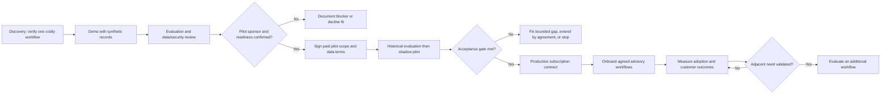
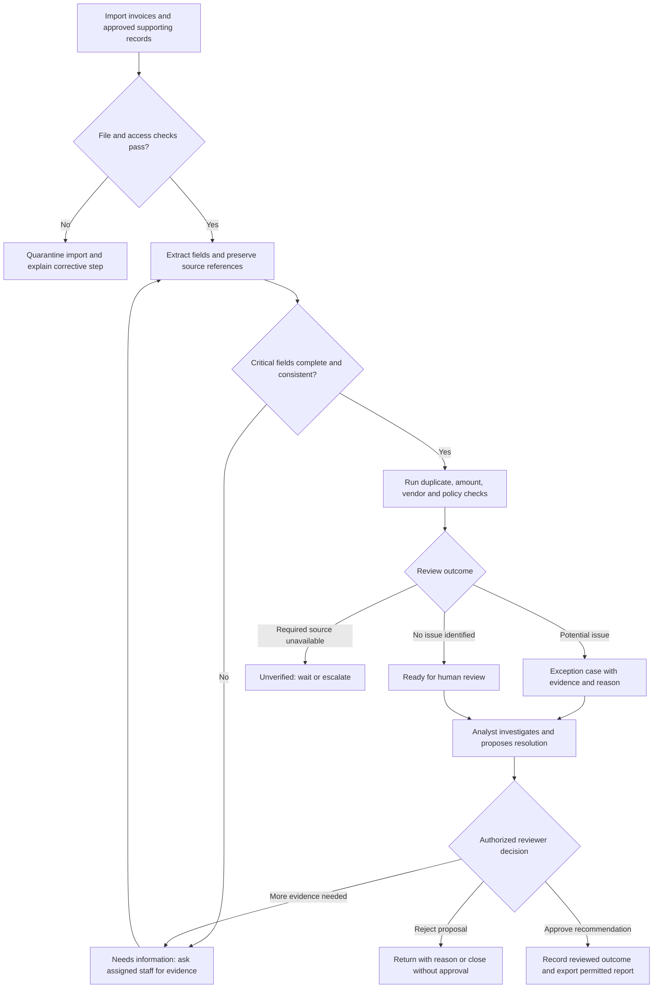
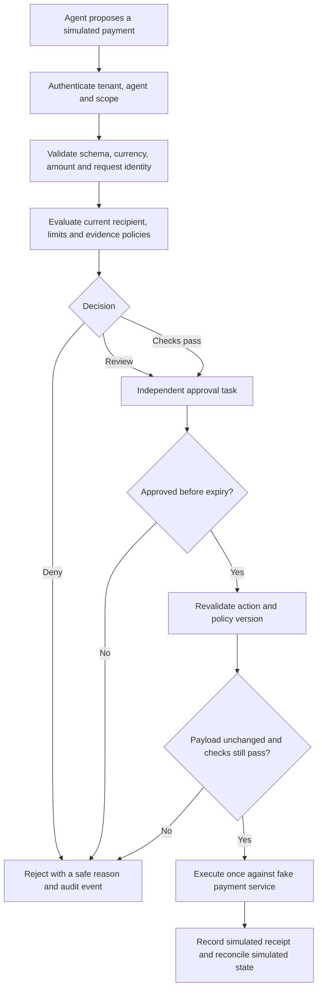
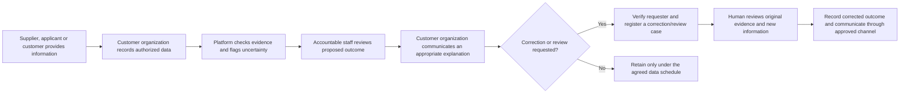

# User, buyer, and operating flows

Planning baseline: 9 October 2026. This is a proposed product and operating model, not evidence of a deployed system, customer demand, regulatory approval, or compliance certification.

## 1. Initial customer and product boundary

Start with **digitally enabled, midsize B2B distributors and wholesalers in India** whose finance teams process supplier invoices and reconcile payments across an accounting system and bank exports. The initial product helps a controller answer: **“Which invoices and reconciliation exceptions need attention, what evidence supports the concern, and who must review the proposed action?”**

Use the following as customer-discovery filters, not claims about the market:

- A CFO, finance head, or controller owns the process and can approve a pilot.
- At least two people participate in invoice checking and approval, allowing meaningful separation of duties.
- Recurring invoice and payment volumes create a measurable review workload; test a provisional range of 1,000–10,000 invoices per month during discovery.
- Invoice files, vendor records, and accounting/bank exports can be obtained with the customer's authorization.
- A specific recurring problem is visible: duplicate submissions, mismatched references, unexplained bank movements, missing approvals, or changed beneficiary details.
- A customer can nominate an operational champion and supply a historical baseline.

The MVP includes invoice review, reconciliation investigation, and **simulated payment controls**. It produces evidence-backed recommendations and a human review queue. It does not send money, post accounting entries, change vendor bank details, or approve a real financial transaction.

### Eight-module scope

| Module | Initial state | User-facing meaning |
|---|---|---|
| Invoice and payment-risk review | MVP | Checks invoice, vendor, purchase-order, and proposed payment evidence; routes exceptions. |
| Reconciliation | MVP | Proposes matches and investigates unmatched or inconsistent entries. |
| Agent payment controls | Simulation only | Demonstrates policy decisions against a fake payment service; clearly marked as a simulation. |
| AML investigation assistance | Disabled; future evaluation | Would assemble evidence and support an investigator's work. |
| Chargeback/dispute evidence | Disabled; future evaluation | Would build evidence packets for merchant review. |
| Underwriting evidence validation | Disabled; future evaluation | Would check file completeness, calculations, and policy exceptions. |
| Collections quality assurance | Disabled; future evaluation | Would review communications and route exceptions. |
| KYC review assistance | Disabled; future evaluation | Would organize identity-review evidence and integrate suitable verification sources. |

Disabled modules must not display fabricated scores, pass/fail conclusions, or a working-looking submission button. A description of future scope is acceptable. Enabling a module requires its own customer problem, validation set, policy ownership, data authorization, and release decision.

## 2. People and responsibilities

The person using the queue is usually not the person buying the software. Establish both early.

| Role | Responsibility and motivation | Product access | Buying role |
|---|---|---|---|
| Accounts-payable analyst | Checks invoices, resolves missing evidence, and proposes corrections. Wants less repetitive checking. | Assigned cases, permitted source records, comments, draft proposals. | Daily user; practical evaluator. |
| Reconciliation analyst/accountant | Resolves unmatched entries and explains differences. Wants a smaller, more reliable exception queue. | Relevant ledger and bank records; proposed matches; reviewed resolutions. | Daily user; practical evaluator. |
| Finance manager/controller | Owns review quality, approval thresholds, and exception routing. Wants consistent decisions and an audit trail. | Review and approval within assigned scope; operational reports. | Champion; process owner; sometimes economic buyer. |
| CFO/finance head/business owner | Owns budget and business outcomes. Wants measurable savings and controlled financial operations. | Aggregate outcomes and agreed high-level oversight. | Economic buyer and renewal decision maker. |
| IT/security administrator | Configures identities, approved integrations, and access reviews. Wants bounded access and a supportable system. | User and integration administration; security events. | Technical approver; does not acquire financial approval authority by default. |
| Procurement/legal/privacy reviewer | Reviews contract, data handling, suppliers, and risk allocation. | Evaluation pack and appropriate administrative information. | May block procurement until requirements are resolved. |
| Internal/external auditor | Reconstructs evidence, policies, and approvals for sampled cases. | Explicitly granted, time-limited read-only access or scoped exports. | Influencer; generally not the operational owner. |
| Supplier/vendor contact | Clarifies an invoice or beneficiary change through the customer's approved channel. | No internal dashboard access in the MVP. | Indirect participant. |
| Product operator/support staff | Diagnoses service failures within a support authorization. | Minimum required metadata; customer data only through recorded, scoped support access. | Vendor staff; never a customer's financial approver. |

One person can hold several organizational titles, but the system should still preserve the separation required for sensitive decisions. If the customer cannot provide an independent approver, keep sensitive workflows advisory or in simulation until an acceptable operating model is agreed.

## 3. Buyer journey

The paid pilot itself needs signed commercial and data-handling terms before receiving customer data. “Production contract” above means the later subscription agreement; it does not mean an informal pilot without a contract.

| Stage | Owner and activity | Concrete artifact | Exit condition |
|---|---|---|---|
| Discovery | Founder plus controller walk through one recent exception. | Current process, baseline time, data map, budget owner, buying process. | Recurring problem, reachable sponsor, and obtainable evidence. |
| Demonstration | Founder shows one invoice case and one reconciliation case using synthetic data. | Short scenario, evidence view, explicit limits, simulated payment rejection. | Users recognize the workflow and identify a case worth evaluating. |
| Evaluation | Champion, IT/security, and relevant procurement/privacy reviewers assess fit. | Data field inventory, deployment proposal, access model, retention proposal, pilot scorecard. | No unresolved prerequisite for the pilot's actual data or access. |
| Paid pilot agreement | Economic buyer and vendor agree on scope and responsibilities. | Defined dataset, named users, price, timeline, metrics, support, exit/deletion process. | Signed authority to start; a funded sponsor; delivery responsibilities assigned. |
| Pilot | Staff compare recommendations with reviewed historical cases, then use an advisory queue. | Baseline, error log, sample-level results, staff feedback, weekly outcome review. | Acceptance criteria met, or a documented stop/fix decision. |
| Subscription decision | CFO/controller reviews results and total operating effort. | Business case, agreed limits, service/support terms, implementation plan. | Budget and required approvals confirmed; contract executed. |
| Onboarding | Administrator, controller, and staff configure the tenant and run a rehearsal. | Access matrix, policy versions, mappings, signed acceptance, support contacts. | Operational rehearsal passes and users know how to handle failures. |
| Renewal/expansion | Buyer and champion review sustained usage, errors, and economics. | Outcome report, renewal proposal, scoped next-workflow evaluation. | Evidence supports renewal or an expansion experiment. |

### Disqualify or defer when

- The only requested value is autonomous live payments before the controls have been validated.
- The buyer cannot authorize data use or establish access to the required records.
- No one can label historical outcomes or review pilot recommendations.
- The pilot requires five bespoke connectors before any value can be observed.
- The sponsor expects guaranteed fraud prevention, guaranteed legal compliance, or replacement of accountable financial reviewers.
- The customer wants a regulated lending, AML, or KYC deployment whose validation and legal requirements exceed the initial product scope.

## 4. Onboarding and separation of duties

### Configuration sequence

1. **Confirm scope:** record the contracting entity, operational owner, enabled modules, permitted datasets, and excluded actions.
2. **Set identity and access:** invite named users; assign entity, account, and case scope; configure authentication; verify that removed users lose access.
3. **Approve data handling:** document the customer-authorized data source, necessary fields, hosting/support access choices, retention periods, deletion process, and incident contacts.
4. **Map records:** identify the vendor key, invoice key, currency, dates, gross/net/tax fields where applicable, payment reference, and ledger/bank account keys. Preserve original files and mappings as separately traceable inputs.
5. **Configure proposed policies:** define duplicate criteria, tolerances, required evidence, approval amounts, and beneficiary-change review. The software supplies a template; the customer supplies and approves the operational policy.
6. **Assign independent approval:** nominate who proposes a policy change and who approves it. Record the version and effective time before activation.
7. **Run historical cases:** inspect correct passes, known exceptions, malformed files, and deliberately adverse scenarios.
8. **Rehearse escalation:** show how to report a wrong flag, request more evidence, assign a substitute reviewer, and stop an import or workflow.
9. **Sign operational acceptance:** the process owner confirms the advisory workflow and simulation labels match the agreed scope.

### Permission model

| Action | Analyst | Financial reviewer | Policy owner | Tenant administrator | Vendor support |
|---|---|---|---|---|---|
| Import approved records | Within assigned scope | Yes, if granted | Only if separately granted | Only if separately granted | No by default |
| View cases and evidence | Assigned scope | Assigned scope | Policy-testing evidence only, unless separately granted | No blanket financial-record access | No by default |
| Propose a match or resolution | Yes | Yes | No automatic permission | No automatic permission | No |
| Approve a sensitive proposal | No self-approval | Within authority; never own proposal | Only with separate reviewer role | No automatic permission | No |
| Propose policy changes | No by default | If designated | Yes | No automatic permission | No |
| Activate sensitive policy changes | No | Designated independent approver | Not own unreviewed change | No automatic permission | No |
| Manage identities/connectors | No | No by default | No by default | Yes | Only temporary, customer-authorized support scope |
| Export evidence | Explicit scoped permission | Explicit scoped permission | Explicit scoped permission | Explicit scoped permission | No by default |
| Send a real payment | Not supported | Not supported | Not supported | Not supported | Not supported |

Changes to approval authority or the approver list deserve independent review as well; otherwise an administrator could bypass the intended separation indirectly. Record break-glass events, constrain their scope and duration, and require review. Break-glass access must not create an unlogged route to executing money movements.

## 5. Staff flow: invoice review

### Screen-level user journey

1. **Import:** staff choose the legal entity, period, and approved data type. A preview lists field mappings and row-level validation problems before submission.
2. **Work queue:** each case displays owner, age, amount/currency, reason, evidence completeness, and current status. “No issue identified” must not be presented as a fraud-free guarantee.
3. **Case detail:** the invoice and supporting record sit alongside the extracted fields, applicable policy version, calculation results, and exact source references.
4. **Investigation:** staff can correct an extraction with a reason, attach authorized evidence, link a duplicate, and request clarification. A bank-detail change creates an independent verification task through the customer's approved process; email text alone is not sufficient verification.
5. **Proposal:** the analyst chooses a typed resolution such as “duplicate submission,” “legitimate recurring invoice,” “incorrect field extraction,” or “needs vendor clarification.” A free-text explanation supplements structured evidence.
6. **Review:** an authorized independent reviewer approves or rejects the proposed resolution. Changed amounts, beneficiaries, or evidence invalidate an earlier approval where relevant.
7. **Completion:** the product exports a reviewed case/report. Actual payment remains in the customer's existing process and outside the MVP.

LLM-written explanations cannot override failed business rules. A reviewer can use a documented exception process only for rules the customer explicitly allows to be overridden. Authorization, tenant isolation, and the restriction on real payment execution are not ordinary overrideable rules.

## 6. Staff flow: reconciliation

1. Import scoped bank and ledger exports; verify account, period, currency, row counts, and available control totals.
2. Preserve source amounts and sign conventions. Convert to an internal representation using explicit mappings; do not let an LLM invent amounts, exchange rates, or missing transactions.
3. Generate candidate matches through reproducible matching logic. The first version can support exact matches and a narrowly defined tolerance policy.
4. Place ambiguous matches, partial payments, duplicate references, fees, and missing counterparts in the review queue. Unsupported match types remain unresolved.
5. Show both sides of a proposed match, why it was proposed, and which records would be consumed by accepting it.
6. Analyst accepts a proposed match for reviewer consideration or rejects it with a reason. Prevent the same source movement from being silently consumed twice.
7. Reviewer approves relevant resolutions. The MVP records the reviewed conclusion and exports proposed adjustments; it does not post journals.
8. Close the period only when the authorized customer owner accepts remaining exceptions. The dashboard must still disclose unresolved items and incomplete imports.

**Example:** a bank debit and ledger payment share an amount but have different beneficiary references. The system should show a candidate requiring review, not silently declare a match because the amount is equal.

## 7. Staff flow: simulated payment controls

All first-release simulated payment proposals require an independent approval, including proposals whose financial checks pass. A review finding must first receive its permitted evidence-backed resolution; a blocking or incomplete mandatory check cannot be cleared by an approval alone. All screens, exports, and event records in this workflow must say **Simulation — no money moves**. There are no production payment credentials in the MVP. The demonstration should include an over-limit request, an unapproved beneficiary, an expired approval, an altered approved payload, and a duplicate request.

In a future real integration, approval must be bound to the exact action and execution must pass through the enforcement layer. A model that merely recommends a safe action cannot secure a separate, bypassable payment API.

## 8. Shared case states, errors, and escalation

| State or event | What the user sees | Required response | Owner |
|---|---|---|---|
| Import rejected | File, field, or access problem with specific affected rows where safe. | Correct input; avoid partial silent ingestion. | Importing analyst. |
| Quarantined content | A document cannot be safely processed. | Review through a controlled process; do not execute embedded instructions. | Administrator/security contact. |
| Needs information | Missing or contradictory evidence. | Request clarification through an approved channel; pause dependent conclusions. | Assigned analyst. |
| Source/provider unavailable | Required check could not be completed; no invented success status. | Retry with bounds or escalate; high-impact dependent actions remain blocked. | Operations/support. |
| Ready for review | Evidence and proposal available. | Assign a reviewer with the necessary authority. | Controller. |
| Approval expired or invalidated | Prior approval no longer applies. | Re-evaluate the current payload and obtain required approval. | Reviewer. |
| Disputed finding | User or affected party challenges a fact or conclusion. | Reopen or link a correction case; assign a human owner. | Process owner. |
| Reviewer unavailable | Approval queue has no available qualified reviewer. | Assign an authorized substitute; do not downgrade controls for convenience. | Controller. |
| Policy conflict | Rules imply incompatible outcomes or configuration is invalid. | Return an explicit error; policy owner resolves it before dependent action. | Policy owner. |
| Duplicate request | A request appears already processed. | Return the existing outcome or require explicit new scope; do not execute twice. | System, then analyst if ambiguous. |
| Suspected data exposure | Access or export anomaly. | Restrict the affected capability, preserve necessary evidence, and follow the agreed incident process. | Security owner and customer contact. |
| Wrong AI explanation | Explanation conflicts with evidence or calculations. | Mark unverified, correct the record, and log the failure for evaluation. | Analyst and product team. |

An escalation timer is an operational target agreed with the customer, not permission to auto-approve when the timer expires. The system must distinguish **“check passed,” “check failed,” and “check not completed.”**

## 9. Indirect flow for suppliers, applicants, and customers

The initial supplier flow is indirect: the finance team owns communication and requests evidence through an approved channel. The MVP should not introduce a public portal or automatically send requests to suppliers.

Future lending, KYC, and collections modules affect individuals who may never see the platform. Their correction and review path must be designed before enabling those modules.

Requirements for this indirect flow:

- Record which organization owns the relationship and is accountable for communicating the outcome.
- Verify the requester before disclosing records. Provide only information appropriate to that person's case and role.
- Use clear explanations of missing evidence or correctable facts. Do not expose another person's data, confidential security controls, or an unsupported accusation.
- Provide an identified human owner for disputed facts, contested outcomes, and an applicable appeal process.
- Preserve the original record and attach corrections with version history. Do not silently rewrite evidence used in a previous decision.
- Re-evaluate downstream conclusions affected by a verified correction; invalidate stale recommendations and approvals when appropriate.
- Treat deletion, retention, access, and appeal handling as requirements to scope with the customer and qualified advisers. This planning document does not assert which legal obligations apply.
- Do not treat a person's refusal to provide optional data as an automatic adverse-risk signal.

The actual notice wording, decision explanations, contact process, and legally required timelines depend on the deployed workflow and must be settled before production use.

## 10. Measures that connect users to buyer value

Use reviewed cases and defined denominators. Time saved is useful only if error rates and reviewer workload remain acceptable.

| Workflow | Outcome metric | Paired quality measure | Evidence required |
|---|---|---|---|
| Invoice review | Median active review minutes per invoice/exception. | Precision of alerts and recall of confirmed issues, reported separately for natural historical and seeded cases. | Labeled cases, timestamps, override reasons, sampled unflagged cases. |
| Reconciliation | Median time per resolved exception; unresolved backlog by age. | Proposed-match precision; missed valid-match rate; erroneous resolution rate. | Reviewed reference matches, unmatched population, record-consumption checks. |
| Payment simulation | Correct allow/review/deny decisions on a versioned scenario suite. | Unsafe scenarios incorrectly allowed and legitimate scenarios incorrectly blocked/referred. | Expected outcomes, policy versions, request/response trace, repeated-request cases. |
| AML assistance, future | Investigator preparation time and narrative rework. | Unsupported statements, missing critical evidence, and unnecessary escalations. | Specialist-reviewed investigation files; no assumed detection performance. |
| Disputes, future | Time to prepare a complete evidence packet. | Unsupported claims and missing relevant evidence. | Reviewer rubric and source documents; outcome attribution separated from case merits. |
| Underwriting evidence, future | Time to assemble and review a file. | Missed policy/evidence defects and unnecessary exceptions. | Expert-reviewed files; fairness and outcome questions evaluated separately. |
| Collections QA, future | Review coverage and correction effort. | Missed violations and falsely flagged permitted communications. | Customer policy, reviewed communications, complaints and correction records. |
| KYC assistance, future | Time to resolve missing/inconsistent evidence. | Missed identity-record discrepancies and unnecessary information requests. | Authorized verification sources and specialist-reviewed cases. |

Common metrics: weekly active staff, proportion of eligible cases reviewed in the product, approval turnaround, reopened cases, unsupported-claim rate, access-control failures, and variable service/support cost per customer.

**Metric definitions:** precision = confirmed issues among flagged cases; recall = detected issues among known issues. A dataset containing only flagged cases cannot establish recall. A high rate on hand-picked synthetic examples does not establish production performance. Sample sizes, exclusions, label uncertainty, and workflow changes must accompany pilot results.

## 11. First onboarding checklist

- [ ] Customer segment and one primary workflow confirmed.
- [ ] Economic buyer, operational champion, analyst, reviewer, and security contact named.
- [ ] Pilot agreement and authorized data scope recorded.
- [ ] Enabled modules and simulation boundary visible.
- [ ] Original records, mappings, and derived outputs remain traceable.
- [ ] Role permissions and independent approval tested.
- [ ] Policy owner and policy approval process assigned.
- [ ] Known-good, known-bad, incomplete, and disputed cases rehearsed.
- [ ] Pilot baseline, scorecard, sample plan, and stop conditions agreed.
- [ ] Support, escalation, correction, export, and end-of-pilot deletion/retention steps agreed.

For sequencing, commercial experiments, and release gates, see [the startup roadmap](06-startup-roadmap.md).
