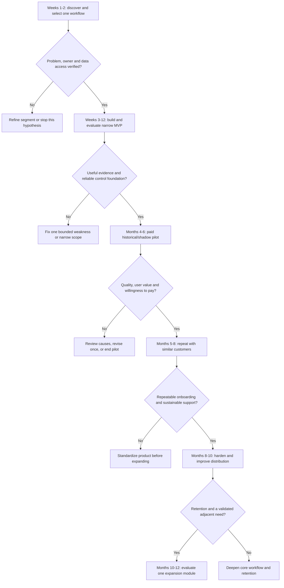

# Startup roadmap: first 12 months

Planning baseline: 9 October 2026. This roadmap assumes an India-first B2B product built by one full-time founder or two builders, with access to a part-time finance-domain reviewer. These are planning proposals. Dates, prices, conversion counts, and performance thresholds below are **unvalidated assumptions or experimental targets**, not market facts, committed delivery dates, customer traction, or investment advice.

## 1. The business to test

**Initial customer:** digitally enabled midsize B2B distributors and wholesalers in India, with a controller/CFO and staff who review supplier invoices and reconcile bank and accounting records.

**Initial promise to test:** reduce the manual work required to resolve invoice and reconciliation exceptions while preserving evidence, approvals, and visibility into errors.

**Initial product:** invoice review and reconciliation investigation, supported by shared evidence, rules, access control, approvals, and audit records. A simulated payment-control workflow demonstrates how the control layer would behave; it is not a live payment product.

**Expansion thesis:** if the evidence and control layer becomes useful and trusted in this workflow, adjacent modules may reuse it. AML, disputes, underwriting, collections, and KYC remain disabled until separately justified and validated. All eight modules are an architecture direction, not the first-year delivery commitment.

### Unknowns to resolve before substantial investment

| Hypothesis | Cheapest useful test | Disconfirming signal |
|---|---|---|
| Exception review is painful enough to fund software. | Observe real cases and ask about current spend, staff time, and consequences. | Problem is rare, already solved satisfactorily, or lacks a budget owner. |
| Customers can provide sufficient records safely. | Ask for a redacted schema/sample after authorization. | Required evidence is inaccessible, unreliable, or incompatible with acceptable data handling. |
| Shared rules generalize across similar customers. | Compare workflows and policy requirements from several prospects. | Every customer requires unrelated logic and bespoke systems before any value. |
| AI adds useful assistance. | Compare deterministic-only output with assisted extraction/explanations on reviewed cases. | AI adds cost and errors without reducing staff effort. |
| Buyers will pay for an advisory workflow. | Offer a defined, paid historical/shadow pilot. | Interest depends entirely on immediate autonomous payments. |
| The workflow supports sustainable economics. | Track implementation and support hours from the first evaluation. | Service effort grows faster than recurring revenue. |

## 2. Operating assumptions and capacity

- A **solo founder** should run customer discovery and one implementation stream, with at most one intensive pilot at a time until onboarding effort is known.
- With **two builders**, one can own ingestion, policy enforcement, and reliability while the other owns review workflows, evaluation, and integrations. Someone must still own customer conversations and commercial decisions explicitly.
- A finance-domain reviewer is needed to define correct outcomes and resolve ambiguous labels. An LLM-generated answer key is not adequate ground truth.
- Specialist security/privacy/legal advice is budgeted when the actual data flow and customer deployment make it necessary. Do not fabricate certification or claim legal sign-off.
- CSV/file imports and a narrow data mapping are the first integration strategy. Add one repeatable connector only after the same need appears across paying evaluations.
- The plan assumes advisory use and synthetic payment execution. Production money movement is a separate investment, validation, and approval decision.
- The stage ranges overlap to accommodate learning. Move by evidence and capacity, not because a month number has arrived.
- A rough engineering assumption is a first pilot during **weeks 13–16 for two experienced builders** with accessible data and narrow scope. A solo founder or someone learning the stack should plan for **four to six months or longer** before that milestone. Neither is an established delivery estimate.
- Develop locally first; evaluate AWS hosting for customer pilots after the data/deployment requirements are known. Shared cloud overhead matters materially with only one to three paying customers.

## 3. Stage gates from zero to month 12

| Stage | Planning range | Deliverables | Proposed gate to advance | Stop, narrow, or revisit when |
|---|---|---|---|---|
| Discovery | Weeks 1–2; extend if access is slow | Interview notes, observed process, competitor/workaround inventory, initial data schema, one buyer profile. | Roughly 10–15 relevant interviews, at least 3 walkthroughs of actual exceptions, and 2 prospects willing to define an evaluation. Counts are learning targets, not proof of demand. | No recurring pain, no budget owner, or data access is impractical. |
| Prototype and historical evaluation | Weeks 3–12 for two experienced builders | Synthetic demo, import validation, evidence-linked cases, deterministic rules, reviewer workflow, simulated payments, first evaluation set. | One narrow workflow can be demonstrated end to end; critical access and action controls pass the agreed test suite; domain reviewer accepts the evaluation rubric. | Accuracy requires unavailable data, scope expands into live payments, or prototype cannot explain its conclusions. |
| Paid pilot | Months 4–6; earliest rough target weeks 13–16; each pilot approximately 4–6 weeks after prerequisites | Signed pilot terms, historical results, advisory queue, baseline comparison, issue log, buyer review. | Buyer agrees the scorecard supports further use; serious defects resolved; at least one paid pilot tests willingness to pay. | Staff cannot use the output, repeated critical failures occur, or no authorized reviewer participates. |
| Repeatability | Months 5–8, overlapping successful pilots | A reusable onboarding package, limited policy templates, support process, consistent reporting. | A planning target of 2–3 paying customers in the same segment, with demonstrably reusable mappings and workflows. No customer count alone proves repeatability. | Each customer requires a new product or support consumes the founder's entire capacity. |
| Reliability and retention | Months 8–10 | Restore drill, incident rehearsal, access reviews, cost controls, documented operations, renewal/adoption evidence. | Customers keep using the core workflow; service quality meets contracted commitments; support effort and contribution economics are viable. | Usage collapses after the pilot, customer value cannot be demonstrated, or defects recur. |
| Selective expansion | Months 10–12 | Discovery and evaluation for one adjacent workflow, or deeper core functionality. | An existing or closely related buyer has a funded need; necessary data and specialists are available; the expansion does not compromise the core. | The expansion needs a different buyer, data model, and regulatory posture without resources to support them. |

**Calendar interpretation:** a solo founder may spend much of the year reaching repeatable paid use. That can be a better result than eight shallow modules. Delayed customer procurement can dominate build time; the ranges above are not delivery estimates backed by historical velocity.

The engineering sequence underlying the two-builder assumption is discovery in weeks 1–2, foundations in weeks 3–4, invoice review in weeks 5–7, reconciliation and payment simulation in weeks 8–10, and pilot readiness in weeks 11–12. The first pilot follows in weeks 13–16 if all release gates pass. This is a planning baseline for the three-workflow MVP, not a commitment to eight production modules within sixteen weeks.

## 4. Customer discovery playbook

### Who to interview

Interview the finance head/controller and the person doing daily exception work separately where possible. Add IT/security early enough to identify data-access constraints. Seek an adviser familiar with the segment, but do not treat adviser enthusiasm as customer willingness to pay.

Potential research channels include existing professional contacts, accountants/CFO advisers, distributor industry networks, and founder communities. Any outreach requires a separate authorized execution step; this document does not send messages, publish material, or contact prospects.

### Suggested 30–40 minute conversation

1. **Context:** “What happens from receiving a supplier invoice to approving it and reconciling the payment?”
2. **Recent concrete case:** “Walk me through the last invoice or bank entry that required more than one person to investigate.”
3. **Evidence:** “Which files, messages, and systems did you open? Which record was treated as authoritative?”
4. **Effort:** “How much active work did it take, who participated, and what waited while it was unresolved?”
5. **Frequency:** “How often does that class of exception happen? Can we inspect a period report rather than rely on memory?”
6. **Failure:** “Which mistakes are costly? Which false alarms would cause the team to ignore a new tool?”
7. **Current workaround:** “What do you already use, what does it cost to operate, and where does it fall short?”
8. **Authority:** “Who can change the process, approve software spend, and authorize data access?”
9. **Evaluation:** “What would a useful four-to-six-week evaluation need to show? What would make you reject it?”
10. **Commercial next step:** “Would you define a paid pilot with a named reviewer and a restricted historical dataset? What approvals would be needed?”

Ask about actual behavior before describing the product. Avoid leading questions such as “Would an AI fraud platform be useful?” Do not request raw bank records or personal information before authority and handling arrangements are established.

### Capture after every interview

- Segment, role, business process, and system environment.
- A specific observed exception and its evidence trail.
- Frequency, staff effort, and financial impact, distinguishing estimates from measured records.
- Existing controls and software; the reason a new product would replace or complement them.
- Buyer, champion, procurement steps, timing, and data-access constraints.
- Strongest objection and evidence that could disprove the product thesis.
- Agreed next action, if any. Record “polite interest” separately from an evaluation commitment or payment.

### Discovery decision

Select the workflow with the best combination of recurring pain, accessible data, an accountable buyer, and a short path to measurable value. If invoice review is weak but reconciliation is strong, narrow the commercial offer to reconciliation; retain invoice review as supporting evidence rather than selling two separate products prematurely.

## 5. Pilot package and evaluation design

### Proposed package

- **Customer:** one legal entity or clearly scoped business unit.
- **People:** one champion, one or two daily users, an independent reviewer, and an IT/security contact.
- **Duration:** approximately four to six weeks after data, permissions, and baseline prerequisites are ready.
- **Scope:** one or two agreed import formats, a bounded historical period, invoice exceptions plus reconciliation, and simulated payment scenarios.
- **Data volume:** agree a manageable dataset after discovery; a provisional range of 300–1,000 records may support a first workflow evaluation, but it may be insufficient to measure rare failure types.
- **Excluded actions:** live payments, direct journal posting, automated external communications, vendor-master changes, and the five disabled future modules.
- **Deliverables:** baseline, reviewed case set, operational comparison, error analysis, outcome report, and agreed export/deletion/retention handling at exit.

### Pilot sequence

1. **Readiness:** sign scope and data terms, verify roles, agree metrics and stop conditions, and obtain approved records.
2. **Baseline:** measure the existing process on a comparable sample; log active handling time separately from time waiting for another person.
3. **Labeling:** have a qualified customer reviewer define correct matches, known issues, legitimate exceptions, and ambiguous cases. Preserve label disagreement instead of forcing false certainty.
4. **Historical evaluation:** freeze a holdout set before tuning. Report results separately by issue class and dataset source.
5. **Advisory use:** staff review recommendations while existing business processes remain authoritative.
6. **Buyer review:** compare effort, error rates, operational burden, willingness to pay, and required fixes. Agree conversion, a bounded extension, or a stop.

### Acceptance scorecard: negotiation starting points

The numbers below are **proposed targets to negotiate**, not expected results or established performance. They must be adjusted to customer risk tolerance, dataset size, and baseline. Passing a finite test set does not prove safety outside it.

| Area | Proposed pilot target | Paired failure measure and interpretation |
|---|---|---|
| Staff effort | At least 25% lower median active handling time on comparable reviewed exception cases. | No increase in reviewer correction or reopened-case rate; report sample count and differences in case difficulty. |
| Invoice issue alerts | At least 80% precision on naturally occurring, reviewer-labeled alerts where sample size permits. | Target at least 90% recall for specifically supported issue classes on the held-out labeled set; separately report false alarms per 100 legitimate invoices and missed issues. |
| Reconciliation candidates | At least 99% precision on the narrowly supported high-confidence candidate class. | Report valid matches not proposed and ambiguous cases deferred; do not achieve a high score by hiding coverage. A small sample cannot establish a 99% population rate. |
| Evidence quality | Every critical reported amount and conclusion has a valid source reference or is explicitly marked unverified. | Zero unsupported critical statements in the reviewed acceptance sample; disclose how many cases were reviewed and whether staff caught a failure. |
| Access and financial control | All mandatory deny scenarios pass the versioned acceptance suite; no cross-tenant access or real-money execution path exists in the MVP. | Also test legitimate allow/review cases so the system does not appear safe merely by blocking everything. |
| Payment simulation | Correct decision for all agreed approval, recipient, amount, expiry, mutation, and duplicate-request scenarios. | Zero duplicate simulated execution; report false denials/referrals on valid requests. This establishes scenario coverage only. |
| Adoption | Named users complete an agreed share of eligible cases in the workflow during the pilot. | Track abandoned cases and work moved to spreadsheets; choose a target after observing the baseline. |
| Commercial viability | Buyer explicitly chooses a paid continuation at a defined scope and price. | Record concessions, implementation effort, and support hours; free continuation is not evidence of willingness to pay. |

For rare adverse events, augment natural data with clearly labeled synthetic or seeded scenarios. Do not mix their counts into a production fraud-detection or loss-prevention claim. Audit a sample of unflagged records to look for false negatives. Report unresolved labels as unresolved.

### Stop conditions

- Unauthorized data access or exposure, missing tenant isolation, or an unintended real-money path.
- A critical check silently reports success when the source or policy evaluation failed.
- Staff repeatedly act on unsupported statements or cannot reconstruct the evidence.
- A customer asks the pilot to perform excluded actions without a revised scope and controls.
- Data is obtained without the required customer authority or agreed handling arrangements.
- Repeated unresolved defects prevent meaningful comparison with the existing process.

Stop the affected capability, preserve necessary diagnostic evidence, notify the agreed customer owner, and follow the incident process. A pilot extension requires an explicit revised objective and acceptance gate; it is not an indefinite free development arrangement.

## 6. Pricing experiments

All figures are **invented India-first experiments**, not competitor prices or evidence of market willingness to pay. Taxes, invoicing treatment, and contractual details require appropriate advice and are not assumed here.

| Offer | Initial experiment | What it tests |
|---|---|---|
| Paid pilot | ₹30,000–₹75,000 once for a defined four-to-six-week scope. | Whether a buyer will fund a concrete evaluation and commit staff time. |
| Subscription | ₹20,000–₹60,000 per organization per month within a defined record-volume and support band. | Whether recurring workflow value supports predictable revenue. |
| Additional volume | A quoted additional band based on measured document-processing and support costs. | Whether price can scale with cost without discouraging useful review. |
| Unusual integration | Separately scoped implementation fee after reviewing actual work. | Whether bespoke effort can be funded rather than hidden in subscription margin. |

Start with one simple commercial offer and record why buyers accept or reject it. Test price alongside scope; a lower price with unlimited support is a different product. Do not base fees on alleged “fraud prevented” when the counterfactual cannot be established. Do not advertise savings percentages without measured customer evidence and permission.

### Value conversation

Build a customer-specific model:

`monthly staff capacity released = eligible cases × baseline minutes per case × observed time reduction ÷ 60`

`illustrative capacity value = released hours × customer's agreed loaded hourly cost`

Capacity released is not automatically cash saved. It may support quicker close, less overtime, or more review coverage. Any avoided-loss claim requires confirmed case evidence and a defensible attribution method; do not count the full value of every flagged payment as recovered money.

## 7. Unit economics and capacity model

Track costs from the first pilot, including human work.

`monthly revenue = subscription + recurring usage fees`

`monthly variable service cost = document/OCR cost + model cost + incremental hosting/storage + paid verification/API cost + allocated support hours × hourly cost`

`monthly contribution = monthly revenue − monthly variable service cost`

`contribution margin = monthly contribution ÷ monthly revenue`

`shared infrastructure allocation per customer = shared monthly environment cost ÷ active customers allocated that cost`

`contribution after shared infrastructure allocation = monthly contribution − shared infrastructure allocation per customer`

`customer acquisition cost = attributable sales/marketing spend + valued sales time, divided by acquired paying customers in a defined cohort`

`acquisition payback months = acquisition cost ÷ positive monthly contribution`

`implementation contribution = implementation/pilot revenue − delivery labor − evaluation/processing costs − other directly attributable costs`

Do not double-count labor between variable support and fixed costs. Treat customer-specific incremental hosting as variable; track shared development/staging/production environment overhead separately. Allocate shared overhead when assessing a customer's economics, but do not subtract it again in a break-even calculation that already includes it in fixed cost. Early founder sales and support are not free merely because no salary is paid. Avoid a lifetime-value calculation until retention and contribution behavior are sufficiently understood.

### Invented illustration, not forecast

| Monthly scenario | Illustrative workable case | Illustrative strained case |
|---|---:|---:|
| Subscription revenue | ₹50,000 | ₹25,000 |
| Variable processing/hosting/API cost | ₹6,000 | ₹8,000 |
| Support assumption | 10 hours × ₹750 = ₹7,500 | 20 hours × ₹750 = ₹15,000 |
| Contribution | ₹36,500 | ₹2,000 |
| Contribution margin | 73% | 8% |

To make the small-customer effect visible, suppose shared cloud/environment overhead is an **invented ₹30,000 per month**. This is a sensitivity-test input, not an AWS quote or expected hosting bill. At one customer the allocation is ₹30,000; at three it is ₹10,000 each; at ten it is ₹3,000 each. The workable case above would then contribute ₹6,500, ₹26,500, or ₹33,500 per customer after that allocation. The strained case is negative at all three illustrated customer counts after this allocation. These figures still exclude other fixed business costs.

These numbers demonstrate sensitivity to support and shared infrastructure costs, not likely outcomes. If total fixed monthly operating cost were an invented ₹1,50,000 **including the ₹30,000 shared infrastructure example**, simple contribution break-even would be approximately 5 customers in the first case and 75 in the second, using direct contribution before shared-cost allocation. That arithmetic is not an operating plan: 75 customers at 20 support hours each would require 1,500 support hours per month and a different cost structure. Add staffing and capacity constraints before interpreting break-even.

For every customer, record onboarding hours, recurring support hours, processed records, model/OCR cost, unresolved issues, gross revenue, discounts, and payment collection status. Use these observations to narrow scope, redesign workflow, or revise price.

## 8. Product and team sequencing

| Responsibility | Solo baseline | Two-builder baseline | Add specialist help when |
|---|---|---|---|
| Customer discovery and sales | Founder reserves recurring time; do not outsource the learning. | One founder is accountable for customer and commercial decisions. | A repeatable segment and pitch exist, and demand exceeds founder capacity. |
| Financial domain quality | Part-time experienced finance reviewer. | Same requirement; not replaced by a second developer. | A new workflow needs AML, credit, KYC, collections, or other specialist expertise. |
| Ingestion and controls | Founder builds the smallest supported pipeline. | Builder 1 owns ingestion, rules, permissions, and execution boundaries. | Production integrations or reliability exceed internal capacity. |
| Review UX and evaluation | Founder limits polish to essential staff tasks. | Builder 2 owns queue, evidence UX, evaluations, and customer onboarding. | Usability or testing becomes the primary bottleneck. |
| Security/privacy/legal | Scope early; obtain advice against actual architecture and contracts. | Same requirement. | Real customer data, enterprise procurement, live money, or regulated workflows introduce specific obligations. |
| Support/customer success | Named founder contact and a bounded support promise. | Rotate operational cover with explicit ownership. | Measured recurring workload justifies the hire. |

**Hiring gate:** hire against an observed bottleneck with funding and a defined role. Do not hire a sales team before the founder can identify a repeatable buyer, sales process, and customer outcome.

## 9. Privacy, regulatory, and operational scoping

This section defines questions to resolve. It does not identify applicable laws, establish legal obligations, or constitute a compliance determination.

Before a production deployment, document:

1. **Entities and activity:** who contracts, who operates the workflow, what financial activity is involved, and whether the customer or product requires specialist authorization or supervision.
2. **Data:** whose information is processed, field necessity, source authority, sensitive information, retention, deletion, correction, and access handling.
3. **Data flow:** hosting locations, model/OCR/API providers, subprocessors, cross-border access or transfers, support access, and whether providers retain or train on submitted content under the chosen terms.
4. **Accountability:** who sets policies, who makes consequential decisions, what human review is required, and who communicates corrections or contested outcomes.
5. **Contracts:** permitted use, customer and vendor responsibilities, data terms, support/service commitments, incident handling, liability allocation, and exit/export process.
6. **Security evidence:** access controls, encryption approach, secrets management, logging, backups, restore testing, vulnerability handling, and incident response appropriate to the actual deployment.
7. **Claims:** remove any unsupported “compliant,” “certified,” “fraud-proof,” or guaranteed-savings statement from demos and sales materials.

Use authoritative sources and qualified advisers for jurisdiction- and activity-specific requirements before launch. An India-first non-lending workflow does not by itself answer every privacy, contracting, outsourcing, or financial-regulatory question. Enabling another module or serving another customer type requires a fresh scope review.

## 10. Risk register and decisions

| Risk | Early signal | Response | Owner |
|---|---|---|---|
| Overbroad eight-module scope | Several buyers and case types compete for the same sprint. | Freeze the MVP boundary; require a written expansion gate. | Founder/product owner. |
| Data access blocks value | No usable authorized records arrive after agreed prerequisites. | Use synthetic evaluation while resolving access; stop the pilot clock or revise scope explicitly. | Customer champion plus founder. |
| False alarms overwhelm staff | Staff ignore flags or review effort increases. | Narrow supported issues, adjust transparent thresholds, and evaluate missed issues as well. | Domain reviewer and product owner. |
| False negatives remain invisible | Evaluation only inspects flagged cases. | Review a sample of unflagged records; build an independently labeled holdout set. | Evaluation owner. |
| Model outputs appear authoritative | Users cite a generated explanation without source review. | Tie outputs to evidence, mark uncertainty, and require accountable approval. | Product and customer controller. |
| Policy/permission bypass | An integration can execute outside the controls. | Remove the bypass; keep execution simulated until the path is enforceable. | Engineering owner. |
| Services-heavy economics | Every customer needs extensive mapping and ongoing intervention. | Standardize one segment/format, charge for custom work, or narrow the offer. | Founder. |
| Sales without retention | Pilot enthusiasm does not produce continued use. | Investigate workflow fit and buyer value before increasing acquisition spend. | Founder/customer owner. |
| Security or privacy incident | Unexpected data access, export, or provider behavior. | Stop affected access, follow the incident process, and repair before resuming. | Security owner. |
| Regulatory misunderstanding | A customer assumes the platform replaces their legal or regulated responsibilities. | Correct scope and claims; obtain appropriate review before proceeding. | Founder with advisers. |

## 11. Fundraising and business milestones

Fundraising is optional and should support a specific next stage rather than substitute for customer evidence. This document does not estimate valuation, funding availability, or investor interest.

| Milestone | Evidence to collect | Decision it supports |
|---|---|---|
| Problem evidence | Observed workflows, buyer interviews, repeatable pain, accessible data. | Whether to invest more founder time. |
| Paid evaluation | Signed scope, actual payment, named users, measurable baseline. | Whether willingness to pay extends beyond verbal interest. |
| Product value | Reviewed error analysis, measured operational improvement, continued staff use. | Whether to refine the product and seek more similar buyers. |
| Repeatability | Several similar customers, reusable onboarding, support/cost trends. | Whether to hire or invest in a repeatable sales channel. |
| Retention | Renewals or continued contractual use, usage consistency, references with permission. | Whether expansion or external capital could accelerate a working business. |
| Expansion readiness | Funded adjacent need, data access, specialist capability, clear evaluation plan. | Whether another module is justified. |

If seeking funding, assemble an evidence pack: customer problem, current product boundary, pilot cohorts and limitations, revenue and costs, retention, risk controls, team capability, and the next milestone funded by the raise. Label unpaid trials, letters of intent, contracted revenue, collected revenue, and speculative pipeline separately. Do not present the eight-module roadmap as eight validated businesses.

## 12. Immediate two-week plan

These are proposed founder tasks, not actions already taken.

| Day range | Work | Tangible output |
|---|---|---|
| Days 1–2 | Choose segment, primary workflow, buyer profile, and excluded actions. | One-page problem brief and customer-discovery list. |
| Days 3–5 | Conduct initial interviews after arranging them; obtain permission for workflow walkthroughs. | Notes on real exceptions, baseline questions, data prerequisites, and buying roles. |
| Days 6–7 | Map a common invoice/reconciliation journey and define case labels. | Process map, sample schemas, reviewer rubric, and first risk list. |
| Days 8–10 | Specify a synthetic demonstration and a restricted paid pilot offer. | Demo storyboard, pilot scorecard, draft scope, and provisional pricing experiment. |
| Days 11–12 | Review with finance-domain and appropriate security/privacy advisers. | Corrected assumptions, unresolved requirements, and release blockers. |
| Days 13–14 | Decide whether evidence justifies building the narrow MVP. | Written go/narrow/stop decision, next milestone, and owner for each open issue. |

For individual buyer, staff, and indirect customer flows, see [user and buyer flows](05-user-and-buyer-flows.md).
